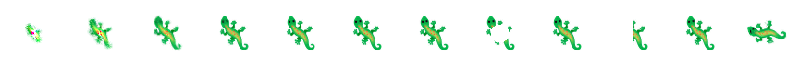

# Growing Neural Cellular Automata

A reimplementation of [Growing Neural Cellular Automata](https://distill.pub/2020/growing-ca/) (Mordvintsev, Randazzo, Niklasson, Levin; Distill 2020), the paper that grows a 🦎 from a single cell and regrows it after damage. Training is PyTorch on CUDA. Interaction is a native Rust app built on egui, which runs the trained rule on the CPU so you can erase part of the creature and watch it regenerate.



## Layout

| path | what it is |
|---|---|
| `SPEC.md` | The update rule and model file format both sides implement. |
| `train/nca.py` | The model: 16-channel state, Sobel perception, 48→128→16 MLP, stochastic updates, alive masking. |
| `train/train.py` | Trains one emoji under one regime (`growing`, `persistent`, `regenerating`). |
| `train/train_all.py` | Trains many (emoji, regime) pairs as concurrent processes. |
| `train/evaluate.py` | Scores growth, persistence, regeneration and rotation, and renders filmstrips to `eval/`. |
| `train/plot_losses.py` | Training curves to `eval/loss_curves.png`. |
| `train/hillclimb_round.sh` | Runs training variants across seeds for optimisation experiments. |
| `train/promote.py`, `train/select_seeds.sh` | Ship the best seed per emoji, judged on held-out rollouts. |
| `train/make_fixture.py` | Writes `fixtures/step_fixture.json`, the numeric contract the Rust engine is tested against. |
| `viewer/` | The egui app and its CPU engine. `viewer/scripts/drive_xvfb.sh` drives it end to end on a private Xvfb display. |
| `models/` | Trained models (`<emoji>_<regime>.json`); `.pt` checkpoints and logs are not committed. |

## The three regimes

The paper's three experiments, trained for each of its ten emojis (🦎 😀 💥 👁 🐠 🦋 🐞 🕸 🥨 🎄):

- **growing** trains from the seed alone. It grows the shape within ~96 steps but nothing tells it to stop, so it keeps growing.
- **persistent** samples starting states from a pool of its own past outputs, which teaches it to hold the shape as an attractor.
- **regenerating** is persistent plus random circular damage to the three best samples in each batch, which teaches it to repair.

## Running the viewer

```sh
cd viewer
cargo run --release                     # opens on gecko_regenerating, already growing
cargo run --release -- --models ../models
cargo run --release -- --bench ../models/gecko_regenerating.json --grid 72 --steps 3000
```

| input | action |
|---|---|
| left drag | erase a disc of cells (all 16 channels zeroed) |
| right click | plant a new seed |
| Space / S / R | play-pause / single step / reset to one seed |
| sliders | steps per frame, fire rate, rotation (rotates the perception kernels, as in the paper), brush radius |
| buttons | random damage (the trainer's circle damage), cut left half, grid size 72 to 256 |
| view menu | RGB over white, alpha, any hidden channel 4..15, hidden 4,5,6 as RGB |

The stats panel shows the step count, steps per second, live cells, and MSE against the target (the training loss, meaningful at rotation 0 on the 72 grid). `.cargo/config.toml` builds for the native CPU (AVX2/FMA). Delete it for a portable binary.

## Training

```sh
cd train
uv sync                                                    # torch cu128 (needs a Blackwell-capable build for the 5090)
uv run python train.py --emoji gecko --experiment regenerating
uv run python train_all.py --jobs 3                        # all 30 models
uv run python evaluate.py                                  # every model in ../models
uv run python plot_losses.py
uv run pytest -q
```

Hyperparameters follow the paper: Adam at 2e-3 dropping to 2e-4 after 2000 steps, 8000 steps, batch 8, a random 64 to 96 CA steps per iteration, per-parameter gradient normalisation, a pool of 1024, fire rate 0.5. `--overflow W` adds a penalty on states outside [-1, 1] (off by default; see Optimisation).

## Optimisation

**Training throughput.** On this RTX 5090 Laptop GPU (95 W cap) one iteration of batch 8 takes 51.6 ms eager and 32.1 ms with `torch.compile` on the step (1.6x faster; single run of 4 repetitions). bf16 autocast adds almost nothing on top (31.3 ms), so training stays fp32. Iteration time grows linearly with batch size (49, 226, 528 ms at batch 8, 32, 64), and the GPU sits at its power cap with SM clocks throttled to about 1.4 GHz. Running more processes in parallel therefore buys nothing, and each model takes about 15 minutes when three train side by side.

**Model quality.** The score is MSE at step 2000 plus mean MSE 200 steps after five fixed damage patterns. Seed-to-seed variance turned out larger than the effect of any variant tried:

| experiment | runs | finding |
|---|---|---|
| overflow penalty (gecko) | 3 seeds vs 3 | Regeneration unchanged (median 0.00046 vs 0.00039, ranges overlap). Rotated growth better in all three seeds (0.0011 to 0.0020 vs 0.0022 to 0.0034). Suggestive, n=3. |
| overflow penalty (spiderweb) | 3 vs 3 | Never explodes (step-2000 MSE 0.0005 to 0.0009) where baseline ranges from 0.0001 to 0.0143. Best single model is still a baseline seed. |
| batch 16 (spiderweb) | 3 vs 3 | Ranges overlap with batch 8. Seed 1 blows up at both batch sizes. Inconclusive. |
| best-of-seeds selection | 3 seeds per emoji | `promote.py` ships the best candidate, judged on held-out rollouts (32 runs, a different RNG seed). Gecko 0.00062 → 0.00034, spiderweb 0.00935 → 0.00092, tree 0.00411 → 0.00178. Fish, ladybug and pretzel: no gain (seed 0 was already best or tied). |

Filmstrips and tables for every candidate are in `eval/hillclimb/`.

## Results

Every shipped model, scored by `evaluate.py` (MSE of premultiplied RGBA against the target, mean of 16 stochastic runs). Full table with growing and persistent models in `eval/results.md`, filmstrips in `eval/*.png`, training curves in `eval/loss_curves.png`.

| model | step 96 | step 2000 | after damage | 200 steps later | rotated 45° |
|---|---|---|---|---|---|
| boom | 0.00055 | 0.00011 | 0.02937 | 0.00047 | 0.00304 |
| butterfly | 0.00048 | 0.00006 | 0.02071 | 0.00054 | 0.00148 |
| eye | 0.00019 | 0.00423 | 0.02467 | 0.00038 | 0.00259 |
| fish | 0.00101 | 0.00035 | 0.03123 | 0.00295 | 0.00315 |
| gecko | 0.00023 | 0.00004 | 0.01212 | 0.00023 | 0.00200 |
| ladybug | 0.00113 | 0.00013 | 0.01815 | 0.00216 | 0.00512 |
| pretzel | 0.00179 | 0.00036 | 0.02836 | 0.00666 | 0.00242 |
| smiley | 0.00174 | 0.00074 | 0.03947 | 0.01015 | 0.00292 |
| spiderweb | 0.00087 | 0.00003 | 0.00896 | 0.00085 | 0.01012 |
| tree | 0.00065 | 0.00012 | 0.01680 | 0.00200 | 0.00263 |

The three regimes reproduce the paper across all ten emojis. Growing models score best at step 96 and then overgrow; by step 2000 the fish state reaches 1.8e21 and the smiley NaN. Persistent models hold the shape but recover little from damage. Regenerating models do both. Weakest: 😀 recovers to 0.010, mostly because faint regrown eyes cost a lot over its large area, and 👁 drifts slightly by step 2000.

## Tests

- `cd viewer && cargo test --release` checks the Rust step against the PyTorch fixture (max abs error 2.4e-7 at angles 0 and 0.7), against a literal transcription of SPEC.md, and covers seeding and alive-masking edge cases.
- `cd train && uv run pytest -q` checks seeding, alive masking, target preprocessing and the JSON round trip.
- `viewer/scripts/drive_xvfb.sh <dir>` launches the app on its own Xvfb display, grows, pauses, erases, regrows and switches model, saving screenshots. It never sends input to your desktop.
