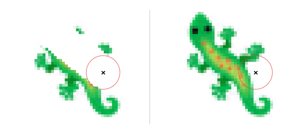
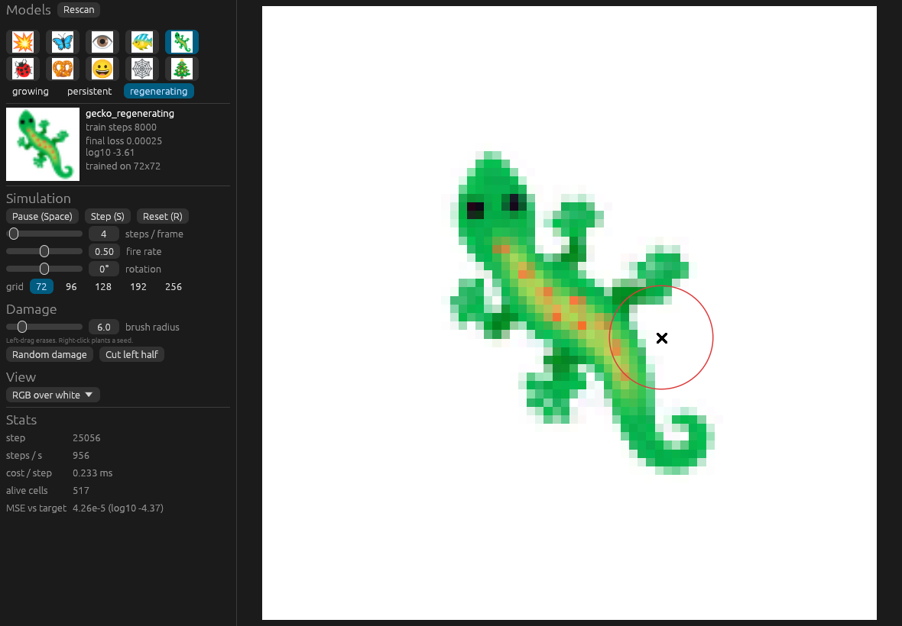

# Growing Neural Cellular Automata

A from-scratch reimplementation of [Growing Neural Cellular Automata](https://distill.pub/2020/growing-ca/) (Mordvintsev et al., Distill 2020), the paper where a single cell grows into a 🦎 and grows back the parts you cut off.

Training runs in PyTorch on a CUDA GPU. A native Rust app built on [egui](https://github.com/emilk/egui) runs the trained models on the CPU. You can erase part of the creature with the mouse and watch it grow back.



The repository ships 30 trained models: the paper's ten emojis (🦎 😀 💥 👁 🐠 🦋 🐞 🕸 🥨 🎄), each trained under its three regimes (growing, persistent, regenerating).



## Quick start

You need [Rust](https://rustup.rs) 1.85 or newer. The trained models are already in `models/`, so no GPU is needed to run the viewer.

```sh
git clone https://github.com/Aurumdev952/growing-nca.git
cd growing-nca/viewer
cargo run --release
```

The app opens with the gecko already growing. Drag with the left mouse button to erase cells. Space pauses and R resets. Pick another emoji or regime in the side panel. [docs/viewer.md](docs/viewer.md) lists every control.

On Linux, egui needs the usual X11 or Wayland and OpenGL libraries. On Debian or Ubuntu run `sudo apt install libxkbcommon-dev libgl1-mesa-dev`.

## Training your own models

You need an NVIDIA GPU with CUDA 12.8 support and [uv](https://docs.astral.sh/uv/).

```sh
cd train
uv sync
uv run python train.py --emoji gecko --experiment regenerating
```

One model takes about 15 minutes on an RTX 5090 Laptop GPU and is written to `models/`, where the viewer picks it up. See [docs/training.md](docs/training.md) for every option.

## Documentation

| document | contents |
|---|---|
| [docs/viewer.md](docs/viewer.md) | Controls, views, command-line options and benchmarking. |
| [docs/training.md](docs/training.md) | The three regimes, hyperparameters, training, evaluation and tests. |
| [docs/results.md](docs/results.md) | Scores for every shipped model, with filmstrips and training curves. |
| [docs/optimisation.md](docs/optimisation.md) | Training throughput and the experiments behind the shipped models. |
| [docs/model-format.md](docs/model-format.md) | The update rule and model file format that Python and Rust share. |

## Credits

- The method comes from Alexander Mordvintsev, Ettore Randazzo, Eyvind Niklasson and Michael Levin, [Growing Neural Cellular Automata](https://distill.pub/2020/growing-ca/), Distill, 2020.
- The target images are from [Noto Emoji](https://github.com/googlefonts/noto-emoji) by Google, used under the Apache License 2.0.

## License

[MIT](LICENSE). The Noto Emoji images in `train/emoji/` keep their Apache 2.0 license.
