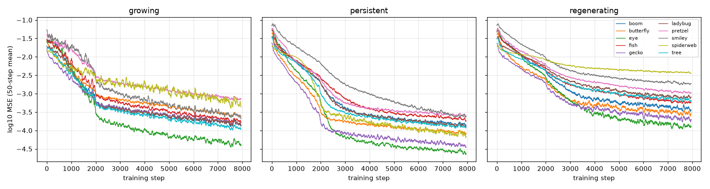

# Results

Every shipped regenerating model, scored by `train/evaluate.py`. Each number is the MSE of premultiplied RGBA against the target, averaged over 16 stochastic runs. "After damage" is measured right after five fixed damage patterns applied at step 300, averaged. "200 steps later" is the same runs after they have had time to repair.

| model | step 96 | step 2000 | after damage | 200 steps later | rotated 45° |
|---|---|---|---|---|---|
| 💥 boom | 0.00055 | 0.00011 | 0.02937 | 0.00047 | 0.00304 |
| 🦋 butterfly | 0.00048 | 0.00006 | 0.02071 | 0.00054 | 0.00148 |
| 👁 eye | 0.00019 | 0.00423 | 0.02467 | 0.00038 | 0.00259 |
| 🐠 fish | 0.00101 | 0.00035 | 0.03123 | 0.00295 | 0.00315 |
| 🦎 gecko | 0.00023 | 0.00004 | 0.01212 | 0.00023 | 0.00200 |
| 🐞 ladybug | 0.00113 | 0.00013 | 0.01815 | 0.00216 | 0.00512 |
| 🥨 pretzel | 0.00179 | 0.00036 | 0.02836 | 0.00666 | 0.00242 |
| 😀 smiley | 0.00174 | 0.00074 | 0.03947 | 0.01015 | 0.00292 |
| 🕸 spiderweb | 0.00087 | 0.00003 | 0.00896 | 0.00085 | 0.01012 |
| 🎄 tree | 0.00065 | 0.00012 | 0.01680 | 0.00200 | 0.00263 |

The full table, with the growing and persistent models, is in [`eval/results.md`](../eval/results.md).

## The three regimes

The results reproduce the paper's three findings for all ten emojis:

- **Growing** models score best at step 96, then keep growing. By step 2000 the fish state reaches 1.8e21 and the smiley turns into NaN.
- **Persistent** models hold their shape for 2000 steps but recover little from damage.
- **Regenerating** models hold their shape and repair it.

## Weak spots

- 😀 recovers least (0.010). The regrown eyes come back faint, and that costs a lot over its large area.
- 👁 drifts slightly by step 2000 (0.0042).
- 🕸 grows poorly when rotated (0.010), probably because its thin radial lines depend on direction.

## Filmstrips

Each filmstrip shows growth from the seed, damage and repair, and growth with rotated kernels.

The filmstrips for every model are in [`eval/`](../eval/). The training curves are in [`eval/loss_curves.png`](../eval/loss_curves.png).

